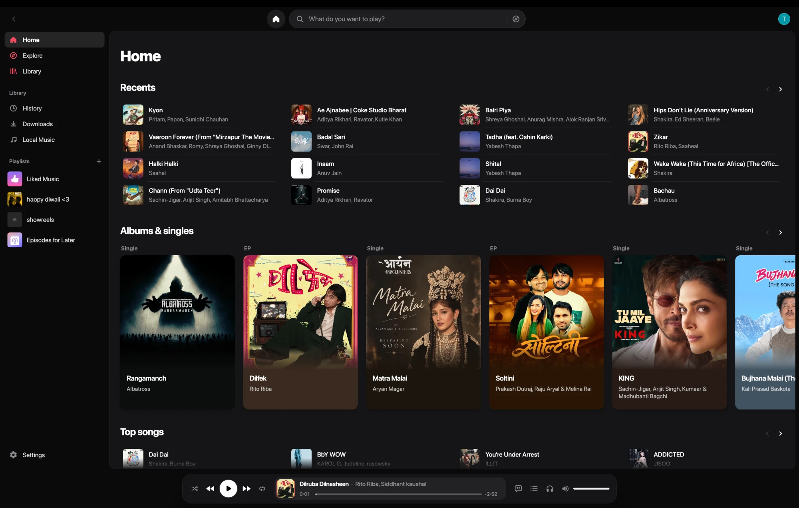
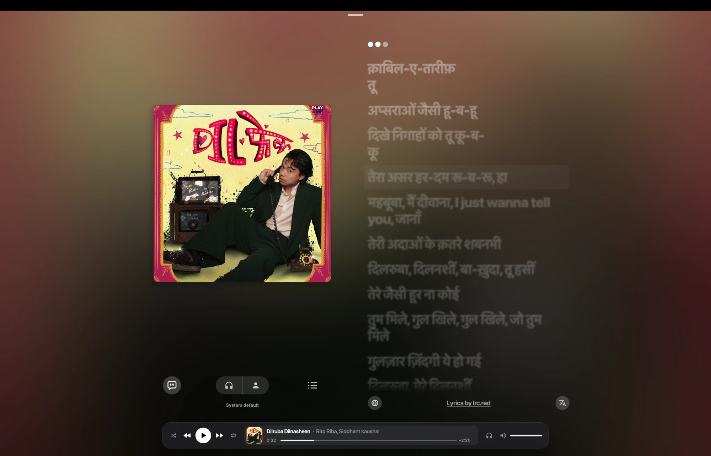
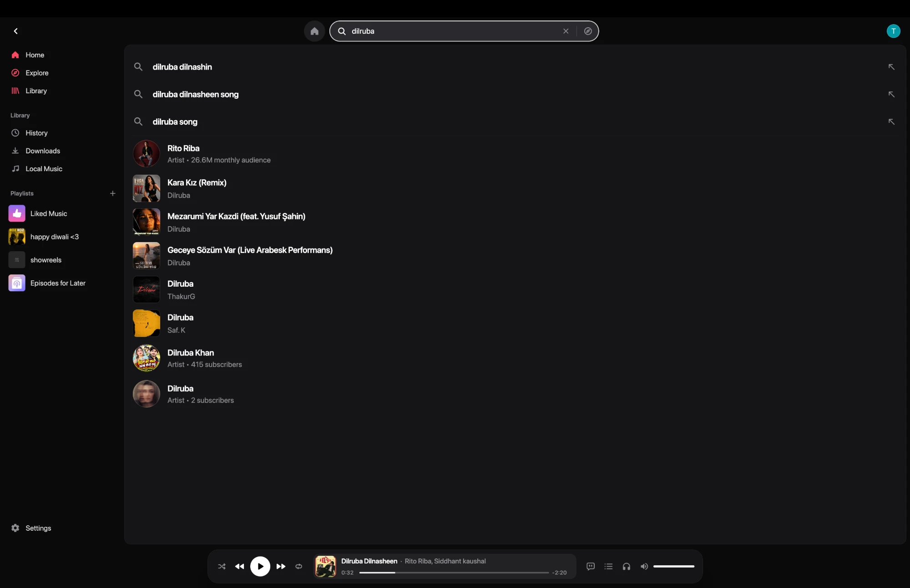

<div align="center">


# BitChord Desktop Continued

### The BitChord desktop app, kept going — with a macOS-native redesign

</div>

> **Based on [BitChord](https://github.com/kushagrasinghx/BitChord) by [kushagrasinghx](https://github.com/kushagrasinghx).**
> The original desktop version was discontinued; this is a continued version.
> All credit for BitChord itself goes to the original author and its contributors.

> [!IMPORTANT]
> BitChord is not affiliated with, endorsed by, or connected to YouTube or Google in any way. Use it at your own discretion.

## What this is

BitChord is a YouTube Music client with an Apple Music-inspired look. The original project
removed its desktop app (Kotlin Multiplatform + Compose Desktop) in favour of a web player.
This fork picks the desktop app up from the 1.8 line and continues it, starting with a version
that feels at home on a Mac.

Only the desktop app is developed here. The Android, backend and shared code in this
repository are the 1.8 versions the desktop app is built on; for the phone, TV, Wear OS and
web apps, use the [original project](https://github.com/kushagrasinghx/BitChord).

## Screenshots

<div align="center">

<br/><br/>

<br/><br/>

</div>

## Features

**New in this continued version**

- **Runs on macOS**, built and packaged as a normal Mac app (the original desktop app targeted Linux and Windows only).
- **Mac-native window**: content runs under the title bar, with the three window buttons in a unified strip.
- **Centered search bar**, an **Apple Music-style Home** and sidebar, and the **player bar in its own strip** under the page.
- **Trackpad gestures** that follow your fingers:
  - swipe or flick **up** on the player bar to open the full player;
  - swipe or flick **down** on the full player to close it;
  - swipe **left / right** for the next or previous track;
  - **scroll over the volume** to change it.
- **Double-click** empty space in the full player to close it.
- Faster startup, a fixed seek bar playhead, and no "update available" prompt pointing at phone releases.

**Carried over from BitChord**

- Search, browse and play anything on YouTube Music, with your Google account if you sign in.
- Gapless playback with crossfade, Automix, an equalizer, and playback speed control.
- Synced lyrics, queue, downloads and a local music library.
- Discord Rich Presence, Last.fm and ListenBrainz scrobbling, Listen Together.

## Install

### macOS

1. Download the `.dmg` from the [Releases page](https://github.com/editorroshan/Bitchord_Desktop_Continued/releases).
2. Open it and drag **BitChord** into **Applications**.
3. The app is not signed with an Apple developer certificate, so the first launch is blocked.
   Open **System Settings › Privacy & Security**, scroll down, and click **Open Anyway** next to BitChord.

The download carries its own Java runtime; nothing else needs installing.

### Windows and Linux

There are no ready-made downloads for these yet. The code still supports them, so you can
[build from source](#build-from-source) on the system you want to run it on. The redesign has
so far only been tested on macOS, and the finger-following trackpad gestures are macOS-only;
elsewhere they fall back to simpler scroll-based ones.

## Build from source

You need **Java 21** (a JDK) and git.

```bash
git clone https://github.com/editorroshan/Bitchord_Desktop_Continued.git
cd Bitchord_Desktop_Continued
```

Run it straight from the source:

```bash
./gradlew :desktopApp:run
```

Build an installer for the system you are on:

| System | Command | Result |
|---|---|---|
| macOS | `./gradlew :desktopApp:packageDmg` | `desktopApp/build/compose/binaries/main/dmg/` |
| Windows | `gradlew.bat :desktopApp:packageExe` (or `packageMsi`) | `desktopApp\build\compose\binaries\main\exe\` |
| Linux | `./gradlew :desktopApp:packageDeb` (or `packageRpm`) | `desktopApp/build/compose/binaries/main/deb/` |

An installer can only be built on the system it is for. More detail is in [DESKTOP.md](DESKTOP.md).

## Credits

- **[kushagrasinghx](https://github.com/kushagrasinghx)** and the BitChord contributors — the original app this is built on.
- Lyrics animation credit, as in the original: [binimum](https://github.com/binimum/am-lyrics).
- macOS redesign and continued desktop work: [editorroshan](https://github.com/editorroshan).

## License

This project is licensed under the **GNU General Public License v3.0**, the same license as the
original BitChord. See [LICENSE](LICENSE). You are free to use, change and share it, as long as
your version stays under the same license and its source code is made available.
